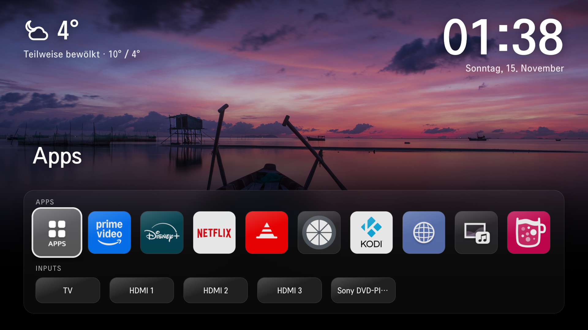
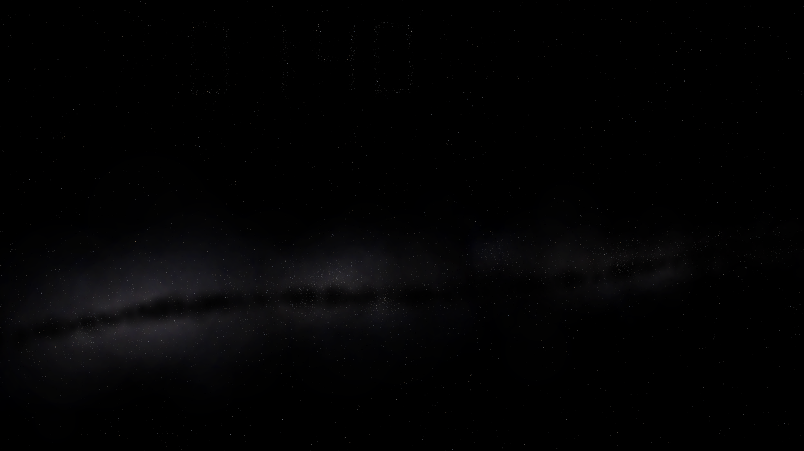

# MyGlassHome

Custom Home Launcher for LG TVs running Glasshouse. Download the Zip File, upload it in the Dashboard and select it.

Follow the official documentation when unsure.

https://rorygallagher2024.github.io/glasshouse/dashboard/home/#custom-launcher

Setting up the weather widget

The weather is off by default. To show the weather for your town:

1. Find your coordinates. Search for your town on openstreetmap.org, right-click on the map and choose "Show address". Use your town, not your exact address. Rounded to two decimals is precise enough, for example Berlin is 52.52, 13.40.
2. Edit index.html. Unzip MyGlassHome.zip, open index.html in a text editor, and find this line:
var WEATHER = null;
   Replace it with your coordinates:
var WEATHER = { lat: 52.52, lon: 13.40 };
   Lat comes first (north–south), then lon (east–west). Use a dot, not a comma, as the decimal separator.
3. Zip it again. index.html must sit at the top level of the zip, next to the wallpapers folder, not inside another folder. On a Mac, open Terminal in the unzipped folder and run:
zip -r MyGlassHome.zip index.html wallpapers
   On Windows, select index.html and wallpapers together, right-click and choose "Send to → Compressed (zipped) folder".
4. Upload it. In Glasshouse's Home tab, upload the zip under Custom.

The weather comes from Open-Meteo, which is free and needs no account or key. Only the coordinates you enter are sent. The widget refreshes every 15 minutes. To turn it off again, set the line back to var WEATHER = null;.

# Starry Sky

The screensaver is a true-black night sky full of shimmering stars, the Milky Way, the odd distant shooting star, a 24h clock drawn in stars that moves to a new spot every 10 minutes, and a slow camera pan to a brand-new sky every 30 to 40 minutes. Made for OLED.

# Project Screenshots

